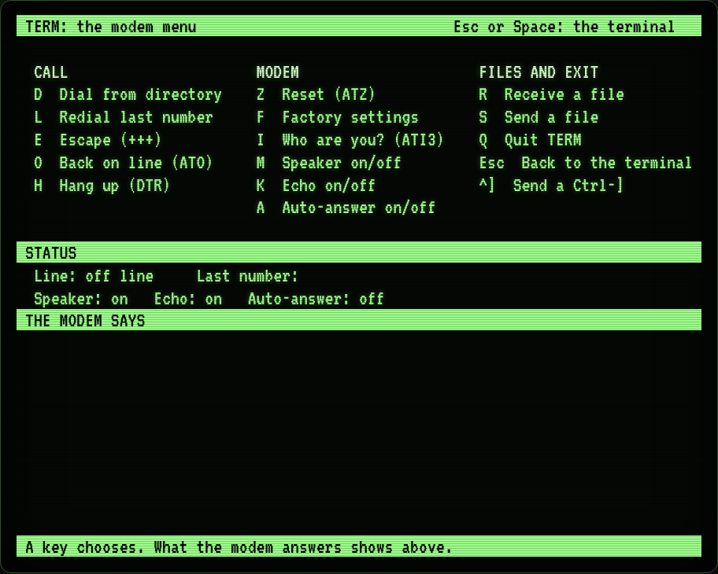
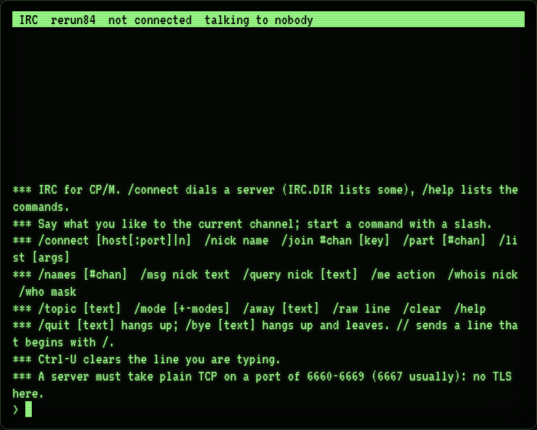

# Dialtone

Two programs for a CP/M machine with a modem on its serial port: **TERM**, a terminal you
dial out with (a bulletin board, a telnet host, XMODEM file transfer), and **IRC**, an IRC
client. 8080 assembly, CP/M 2.2, a VT100 screen of 80x24, plain ASCII, no colour. Together
about 10K of program.

| TERM | IRC |
|---|---|
|  |  |

They were written for [DigitalRerun](https://github.com/cstroie/digital-rerun), a CP/M computer
in the browser, whose modem they were made to drive, and that is where they run out of the box
(see [Hardware](#hardware) for what any other machine must provide). The same sources serve
the boot disk (TERM) and the **Online** shelf disk (both).

## TERM

What you type goes out of the modem, what comes in goes to the screen. Talk to the modem in AT
commands: `ATDT` and a number or a name. **Ctrl-]** opens a full-screen menu (the keys on top,
the state of the line and the modem's answers below):

| Key | |
|---|---|
| `D` | dial a number from `TERM.DIR` (or type one) |
| `L` | redial the last number |
| `Z`, `F` | reset the modem; factory settings |
| `E`, `O` | escape to command mode (`+++`); back on line (`ATO`) |
| `M`, `K`, `A` | speaker, echo and auto-answer on and off |
| `I` | ask the modem who it is (`ATI3`) |
| `R`, `S` | receive and send a file, XMODEM (checksum, 128-byte blocks) |
| `H` | hang up (drops DTR) |
| `Q` | quit TERM (the call stays up; run `TERM` again to come back) |
| `Esc` or `Space` | back to the terminal; `Ctrl-]` in the menu sends a Ctrl-] |

```
A>TERM
ATDT0100            the Digital Rerun BBS
```

## IRC

It dials a server through the modem, registers (`NICK`, `USER`) and talks IRC. A status bar on
the top row (your nick, the server, who you are talking to), the messages scrolling below it,
your line (76 characters; backspace edits, Ctrl-U clears) on the bottom row. A line that does
not start with a slash is said to the current channel or person; `//text` says a line that
begins with a slash.

| Command | |
|---|---|
| `/connect [host[:port] \| n]` | dial a server; no argument lists `IRC.DIR`; a one- or two-digit number is a line of it |
| `/nick name` | set the nick (before a connection) or change it |
| `/join #chan [key]`, `/part [#chan]` | the channel you join is where you talk |
| `/msg nick text`, `/query nick [text]`, `/me action` | private messages; `/query` makes a person the target |
| `/list`, `/names`, `/whois`, `/who`, `/topic`, `/mode`, `/away` | the rest of the line goes to the server |
| `/raw line` | a line to the server as it is |
| `/quit [text]`, `/bye [text]` | hang up (IRC stays); hang up and leave |
| `/help`, `/clear` | the commands; clear the screen |

Plain TCP only: the program does no TLS, so the server must listen on a port of 6660-6669
(6667 usually).

## The directories

`TERM.DIR` and `IRC.DIR` are plain text files beside the programs, one place per line, edited
with any CP/M editor (`ED`). Both end at the end of the file or at a `^Z`; the programs read up
to 1536 bytes of it. Examples are in [`examples/`](examples/).

```
TERM.DIR   a number or a host[:port], then a name      0101 telehack.com
IRC.DIR    host[:port], then a name                   irc.libera.chat:6667 Libera.Chat
```

In DigitalRerun both files are generated at build time from the emulator's own dial list
(`js/devices/directory.js`), because the numbers must match what its modem can dial. The
examples here are a copy of what it ships.

## Running

On DigitalRerun: the shelf's *Comm* section, **Online**, *Insert* (in B:), then `B:` and `IRC` or
`TERM`; TERM is also on the boot disk. On a machine of your own, copy `TERM.COM`, `IRC.COM` and
the `.DIR` files you want onto a disk. The docs say more about the system they were made for:
[docs/ONLINE.txt](docs/ONLINE.txt) is the disk's own readme.

## Hardware

The programs talk to the hardware directly, not through the BIOS:

| Port | In | Out |
|---|---|---|
| 6 | modem status: bit 0 byte waiting, bit 1 may send, bit 2 carrier | modem control: bit 0 DTR (dropping it hangs up) |
| 7 | the received byte | the byte to send |
| 20 | the clock: `IN` reads the record latched by an `OUT` | latch the clock |

A status of `0FFh` on port 6 means no modem. The clock gives TERM's and IRC's timeouts and the
XMODEM timing in milliseconds. Console I/O goes through BDOS (function 6, direct console I/O) and
the screen must be a VT100. On a machine that is not DigitalRerun you provide ports 6, 7 and 20
as above.

## Building

The sources are 8080 code in the dialect of CP/M's `ASM.COM`; DigitalRerun's
[`js/asm8080.js`](https://github.com/cstroie/digital-rerun/blob/main/js/asm8080.js) assembles
them (Node.js, no dependencies):

```
ASM8080=/path/to/digital-rerun/js/asm8080.js node build.js [outdir]
node --test            checks TERM.COM and IRC.COM against the sources (skipped without ASM8080)
```

Inside DigitalRerun, where this repository is the submodule `system/dialtone`, no variable is
needed and `node tools/build.js` builds the disks. `TERM.COM` (3.7K) and `IRC.COM` (5.9K) are
committed.

## Files

| File | |
|---|---|
| `term.asm`, `irc.asm` | the sources |
| `TERM.COM`, `IRC.COM` | as built |
| `build.js`, `test/` | the build and its check |
| `examples/` | `TERM.DIR` and `IRC.DIR` as DigitalRerun ships them |
| `docs/` | the disk's readme, the screenshots |

## Licence

MIT, see [LICENSE](LICENSE). Copyright (c) 2026 Costin Stroie.
