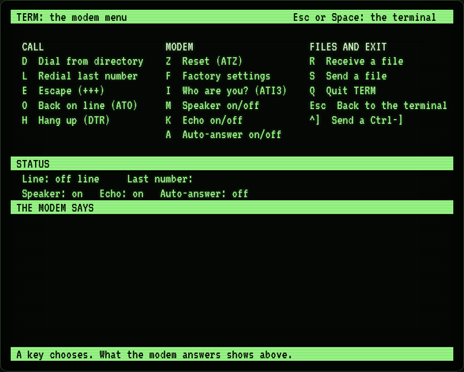
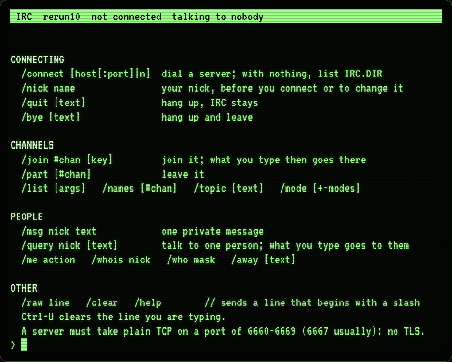

# Dialtone

Programs for a CP/M machine with a modem on its serial port: **TERM**, a terminal you
dial out with (a bulletin board, a telnet host, XMODEM file transfer), **IRC**, an IRC
client, **GOPHER** and **GEMINI**, clients for gopherspace and Geminispace, **MUD**, a client for
text worlds, and two small ones, **FINGER** and **NETTIME**. 8080 assembly, CP/M 2.2, a VT100 screen
of 80x24, plain ASCII, no colour. Together about 28K of program.

| TERM | IRC |
|---|---|
|  |  |

A standalone project, made to drive the modem of [DigitalRerun](https://github.com/cstroie/digital-rerun),
a CP/M computer in the browser, where they run out of the box (see [Hardware](#hardware) for what any
other machine must provide). DigitalRerun builds the same sources into its boot disk (TERM) and the
**Online** shelf disk (all of them).

## TERM

What you type goes out of the modem, what comes in goes to the screen. Talk to the modem in AT
commands: `ATDT` and a number or a name. **Ctrl-]** opens a full-screen menu (the keys on top,
the state of the line and the modem's answers below):

| Key | |
|---|---|
| `D` | dial a number from `TERM.DIR` (or type one) |
| `L` | redial the last number |
| `Z`, `F` | reset the modem; factory settings |
| `E`, `O` | escape to command mode (`+++`); back on line (`ATO`) |
| `M`, `K`, `A` | speaker, echo and auto-answer on and off |
| `I` | ask the modem who it is (`ATI3`) |
| `R`, `S` | receive and send a file, XMODEM (checksum, 128-byte blocks) |
| `H` | hang up (drops DTR) |
| `Q` | quit TERM (the call stays up; run `TERM` again to come back) |
| `Esc` or `Space` | back to the terminal; `Ctrl-]` in the menu sends a Ctrl-] |

```
A>TERM
ATDT0100            the Digital Rerun BBS
```

Or dial from the command line, and TERM starts already calling:

```
A>TERM telehack         a word of a line of TERM.DIR (a name, a host)
A>TERM telehack.com     a host, or host:port
A>TERM 0100             a number: always dialed as it is
```

A word that is in `TERM.DIR` dials that line's first word; anything else is dialed as given
(in lower case; at most 24 characters). A number, or anything that starts with a digit, is never
looked up.

## IRC

On start it shows how to begin (`/connect`, `/connect 1`, `/help`); `/help` lists every command in four groups (connecting, channels, people, other); the welcome and the whole help fit the 22 message rows together, so nothing scrolls off. It dials a server through the modem, registers (`NICK`, `USER`) and talks IRC. A status bar on
the top row (your nick, the server, who you are talking to), the messages scrolling below it,
your line (76 characters; backspace edits, Ctrl-U clears) on the bottom row. A line that does
not start with a slash is said to the current channel or person; `//text` says a line that
begins with a slash.

| Command | |
|---|---|
| `/connect [host[:port] \| n \| word]` | dial a server; no argument lists `IRC.DIR`; a one- or two-digit number is a line of it; a word is the first line that has it |
| `/nick name` | set the nick (before a connection) or change it |
| `/join #chan [key]`, `/part [#chan]` | the channel you join is where you talk |
| `/msg nick text`, `/query nick [text]`, `/me action` | private messages; `/query` makes a person the target |
| `/list`, `/names`, `/whois`, `/who`, `/topic`, `/mode`, `/away` | the rest of the line goes to the server |
| `/raw line` | a line to the server as it is |
| `/quit [text]`, `/bye [text]` | hang up (IRC stays); hang up and leave |
| `/help`, `/clear` | the commands, grouped; clear the screen |
| `?` (alone on a line), `/?` | the same help |
| Ctrl-P, Ctrl-N, or the arrows | the last 10 lines you typed, brought back (Ctrl-U clears) |

From the command line, `IRC` takes the same as `/connect` and dials at once:

```
B>IRC libera            a word of a line of IRC.DIR (a name, a host)
B>IRC 3                 the third line of IRC.DIR
B>IRC irc.example.org   a host, or host:port (the port defaults to 6667)
```

Plain TCP only: the program does no TLS, so the server must listen on a port of 6660-6669
(6667 usually).

## GOPHER

A Gopher client: menus, texts, searches. Alone it shows `GOPHER.DIR` as a home menu; with an
address it goes there at once:

```
B>GOPHER                                  the home menu (GOPHER.DIR)
B>GOPHER gopher.floodgap.com              a host (port 70)
B>GOPHER sdf.org/1/users                  host[:port]/type/selector (gopher:// may lead)
```

The selector is what follows the type, as RFC 4266 has it (`/1/users` is type 1, selector
`/users`). A page is read whole, at the line's speed, with the count of bytes on the bottom row
(Esc stops it and keeps what came), then shown: a menu with its items numbered, a text cut at 79
columns. The top row says where you are; the bottom row says which lines of how many are shown, and a short list of the keys (`?` lists them all).

| Key | |
|---|---|
| a number, Return | follow that item: a text, another menu, a search (it asks for the words) |
| Space or `N`, `P` or `-` | the next page, the one before; Return alone is the next page too |
| `B` | back (the way of 8 places is kept, not the pages: the page before is read again) |
| `G`, `H`, `R` | go to an address typed (Ctrl-P, Ctrl-N: the 10 typed before); home; read this page again |
| `W` | save the page shown to a file, as CP/M text (`d:name.typ`) |
| `?` | the keys, on a page of their own (any key goes back) |
| `Q` | quit |

Kinds it does not show (binaries, pictures, the web) are listed with their type and not followed.
A page can take as much as the TPA leaves (about 45K on a 64K machine); more is cut. The command
line comes in capitals from the CCP, so GOPHER takes it in lower case: a selector with capitals is
typed at `G` instead.

## GEMINI

A Gemini client, built like GOPHER: alone it shows `GEMINI.DIR` as a home page of links; with an
address it goes there at once.

```
B>GEMINI                                  the home page (GEMINI.DIR)
B>GEMINI geminiprotocol.net               a capsule (port 1965)
B>GEMINI gemini://host:1966/path/         gemini:// may lead; another port
```

**TLS is the bridge's.** Gemini needs TLS on every request, which an 8080 cannot do (one handshake
would take minutes): the modem's other end must speak it. DigitalRerun's bridge does, for port 1965
(`&tls=1`; see its docs), and trusts a capsule's certificate the first time, refusing another one
later, as Gemini wants. On another machine you need a modem or a proxy that does the same.

A page is read whole, then shown. Gemtext is laid out for 80 columns: `#` headings bold, paragraphs
wrapped at the words, `* ` lists and `>` quotes set in, preformatted blocks (between ```` ``` ````
lines) as they are, cut at 79 columns. `=>` links are numbered; a link with no name shows its
address. Other text types (`text/plain`...) are shown as they are; anything else says it is not text.

| Key | |
|---|---|
| a number, Return | follow that link (relative addresses, `..`, `?query` resolved against the page's) |
| Space or `N`, `P` or `-` | the next page, the one before |
| `B`, `G`, `H`, `R` | back (the page before is read again); go to an address (Ctrl-P, Ctrl-N: the 10 typed before); home; this page again |
| `W` | save the page's gemtext to a file (`d:name.typ`) |
| `?` | the keys, on a page of their own (any key goes back) |
| `Q` | quit |

The answer's status is followed: `10`/`11` ask for words (the prompt is the capsule's) and send them
percent-encoded after a `?`; `3x` redirects (five at most); `4x`, `5x` and `6x` (client certificates,
which GEMINI has none of) show what the capsule says on a page of their own. Links to other schemes
(`https:`, `gopher:`, `mailto:`) are refused with a word. Up to 255 links and 1500 rows a page.

## MUD

IRC's screen for text worlds: a status bar on top, what the world says in rows 2-23, your line on
row 24, so what comes in never breaks what you type. Return sends the line, an empty one too (the
worlds use it for "more"); Ctrl-P and Ctrl-N, or the arrow keys, bring back the last 10 lines;
Ctrl-U clears. ANSI colour and the other escape codes are left out. After a prompt with
`password` in it, the next line shows as stars and is not kept.

| Command | |
|---|---|
| `/connect [host[:port] \| n \| word]` | dial a world; no argument lists `MUD.DIR`; as IRC's |
| `/quit`, `/bye` | hang up (MUD stays); hang up and leave |
| `/clear`, `/help` | |

`//text` sends a line that begins with a slash. `B>MUD aardwolf` dials a line of `MUD.DIR` at
once. A line goes out with a CR alone; a telnet bridge makes it the end of a line. MUDs speak
telnet: through DigitalRerun's bridge any port works but the raw ones (13, 37, 70, 79, 6660-6669).

## FINGER and NETTIME

```
B>FINGER user@host          what someone's plan says (host:port for another port than 79)
B>FINGER @host              who is on
B>FINGER                    the lines of FINGER.DIR, numbered (no modem needed)
B>FINGER 2                  what line 2 of FINGER.DIR asks
B>NETTIME                   the time from time.nist.gov (daytime, port 13, NIST's format)
B>NETTIME host +2           another clock; an offset from UTC: +h, -h or +h:mm
```

FINGER shows the answer a page at a time (`--More--`: Space, Return a line, Q). NETTIME shows the
UTC time it is given and how far the machine's clock (port 20) is from it; under CP/M 3 it sets
the date and the time (UTC and the offset), reads them back and says whether the BIOS kept them
(DigitalRerun's keeps the host's clock, so there it says it was not).

## The connection

GOPHER, GEMINI, MUD, FINGER and NETTIME share one block of modem code, copied into each source (`ASM.COM`
has no include): a ring for what comes in (filled between every character printed), `ATE0` at the
start and `ATE1` at the end (TERM expects the echo), `ATDT host:port`, the modem's `CONNECT` line
skipped, a minute to answer (a key gives up), and DTR dropped to hang up. A host that answers and
hangs up (finger, daytime, gopher) is read until the carrier goes: the modem must drop DCD after
the data it holds, as a real one does (DigitalRerun's does).

## The directories

`TERM.DIR`, `IRC.DIR`, `GOPHER.DIR`, `GEMINI.DIR`, `MUD.DIR` and `FINGER.DIR` are plain text files beside the programs, one
place per line, edited with any CP/M editor (`ED`). They ship here filled in, ready to copy next to the `.COM` files
(copy them as text, so the file ends in a `^Z`):

```
TERM.DIR   the string to dial, then a name       telehack.com Telehack
IRC.DIR    host[:port], then a name              irc.libera.chat:6667 Libera.Chat: free and open source projects
GOPHER.DIR host[:port][/type/selector], a name   gopher.floodgap.com Floodgap: the hub of gopherspace
GEMINI.DIR a gemini:// address, then a name      gemini://geminiprotocol.net/ Project Gemini
MUD.DIR    host[:port], then a name              aardmud.org:4000 Aardwolf: a big, friendly, long-running MUD
FINGER.DIR user@host or @host, then a name       oslo@graph.no The weather in Oslo
```

- **TERM.DIR** lists up to 16 places, shown in two columns, so keep a line to 37 characters; the
  first word (at most 24 characters) is what `ATDT` gets. The ten here are telnet hosts: BBSes,
  a MUD, NetHack, Telehack, a public-access Unix. They need a modem that dials a host name (a WiFi
  modem, or DigitalRerun's bridge); on a modem that dials numbers, put numbers.
- **IRC.DIR** lists up to 16 servers, ten here (Libera.Chat, OFTC, Rizon, EFnet, DALnet,
  Undernet, QuakeNet, IRCnet, Snoonet, GameSurge), all on port 6667. `/connect` shows them
  numbered; `/connect 3` dials the third.
- **GOPHER.DIR** becomes the home menu, each line an item (a menu unless the address names
  another type); its name is cut at 70 characters.
- **GEMINI.DIR** becomes the home page, each line a link.
- **MUD.DIR** lists up to 16 worlds, as IRC.DIR does.
- **FINGER.DIR** lists up to 16 questions: graph.no's weather (`city@graph.no`, `help@graph.no`
  says how to ask) and who is on SDF.

In DigitalRerun the files are generated at build time from the emulator's own dial list
(`js/devices/directory.js`), because the numbers must match what its modem can dial; the files
here are for every other machine.

## Running

On DigitalRerun: the shelf's *Comm* section, **Online**, *Insert* (in B:), then `B:` and the program;
TERM is also on the boot disk. On a machine of your own, take the `.COM` and `.DIR`
files from the [releases](https://github.com/cstroie/dialtone/releases) and copy them onto a disk. The docs say more about the system they were made for:
[docs/ONLINE.txt](docs/ONLINE.txt) is the disk's own readme.

## Hardware

The programs talk to the hardware directly, not through the BIOS:

| Port | In | Out |
|---|---|---|
| 6 | modem status: bit 0 byte waiting, bit 1 may send, bit 2 carrier | modem control: bit 0 DTR (dropping it hangs up) |
| 7 | the received byte | the byte to send |
| 20 | the clock: `IN` reads the record latched by an `OUT` | latch the clock |

A status of `0FFh` on port 6 means no modem. The clock gives the timeouts and the
XMODEM timing in milliseconds (bytes 11-12 of the record), and NETTIME the machine's date and time. Console I/O goes through BDOS (function 6, direct console I/O) and
the screen must be a VT100. On a machine that is not DigitalRerun you provide ports 6, 7 and 20
as above.

## Building

### On the CP/M machine itself

The sources are 8080 code in the dialect of CP/M's own `ASM.COM`, so the machine can build
them with what it ships with: `ASM`, `LOAD` and `SUBMIT`. Put the system disk in A: and a disk
in B: with the `.ASM` files, `MAKE.SUB` and `MAKEALL.SUB` (copied as text; on DigitalRerun
the **Online** disk already has them, and the `.COM` files get rebuilt in place):

```
A>SUBMIT B:MAKEALL          all seven
A>SUBMIT B:MAKE GOPHER      one of them
```

`MAKE.SUB` is three lines, with `$1` the name:

```
ASM $1.BBZ          source on B:, the .HEX on B:, no listing
LOAD B:$1           .HEX to .COM
ERA B:$1.HEX
```

On the 4 MHz emulator `TERM` takes about 25 seconds and `IRC` about 40, `GOPHER` about 30, `GEMINI` about 45 (a real floppy is slower). For a listing, use `ASM IRC.BBX`
(the listing goes to the screen) or `ASM IRC.BBB` (to `IRC.PRN` on B:).
Things `ASM.COM` does not take, which the sources keep to: no label that is an 8080
mnemonic (`cm`, `cz`...), no string over 64 characters in one `db` operand, no `!` in a
comment, no `HIGH`, `LOW` or `$` arithmetic in `ds`. `IRC` keeps its 256-byte receive ring at the
fixed address 3000h, above the program and its buffers (a test keeps them below it); the
others keep their ring after their buffers, and GOPHER its page above them, up to the BDOS.

### On another machine, with Node.js

DigitalRerun's [`js/asm8080.js`](https://github.com/cstroie/digital-rerun/blob/main/js/asm8080.js)
assembles them (no dependencies):

```
ASM8080=/path/to/digital-rerun/js/asm8080.js node build.js [outdir]
node --test test/*.test.js     the directories' limits, ASM.COM's rules; the .COM files against the sources
```

With a `digital-rerun` folder next to this one, or inside DigitalRerun, where this repository is
the submodule `system/dialtone`, no variable is needed (there `node tools/build.js` builds the
disks). `TERM.COM` (4.0K), `IRC.COM` (6.5K), `GOPHER.COM` (4.1K), `GEMINI.COM` (5.4K), `MUD.COM` (3.6K), `FINGER.COM` (1.8K)
and `NETTIME.COM` (2.7K) are not kept in git: the releases carry them, with the `.DIR` files. The version is in [VERSION](VERSION), the history in [CHANGELOG.md](CHANGELOG.md).
Both builds make the same programs: DigitalRerun's own test builds both ways and
compares them, and runs each program against made-up servers.

## Files

| File | |
|---|---|
| `term.asm`, `irc.asm`, `gopher.asm`, `gemini.asm`, `mud.asm`, `finger.asm`, `nettime.asm` | the sources |
| `MAKE.SUB`, `MAKEALL.SUB` | build on CP/M: `SUBMIT B:MAKEALL` |
| `*.COM` | as built (not in git: the releases) |
| `build.js`, `test/` | the build and its check; the directories' limits |
| `TERM.DIR`, `IRC.DIR`, `GOPHER.DIR`, `GEMINI.DIR`, `MUD.DIR`, `FINGER.DIR` | ready-made directories of places to go |
| `docs/` | the disk's readme, the screenshots |

## Licence

MIT, see [LICENSE](LICENSE). Copyright (c) 2026 Costin Stroie. Dialtone is a separate project from
DigitalRerun: DigitalRerun only builds and ships the programs, under this same licence, and its own
licence terms do not apply to them.
